<div align="center">

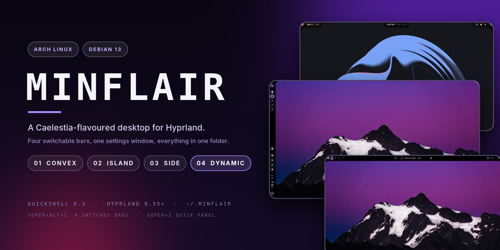

# Minflair

**🌸 A Caelestia-flavoured desktop for Arch and Debian.**

Four switchable bars, a frame that panels grow out of, a round-avatar dashboard, and a settings window that stays out of your way.
Quickshell 0.3 and Hyprland (Lua) on **Arch Linux** and **Debian 13**, all inside `~/.minflair`.


📦 [Install](#install) · 🎛️ [Bars](#bars) · 📊 [Dashboard](#dashboard) · ⚙️ [Settings](#settings) · ⌨️ [Keybinds](#keybinds) · 🛠️ [Troubleshooting](#troubleshooting)

</div>

---

<a id="table-of-contents"></a>

## 📖 Table of contents

1. ✨ [Highlights](#highlights)
2. 📸 [Showcase](#showcase)
3. 📦 [Install](#install)
4. 🔄 [Update and uninstall](#update-and-uninstall)
5. 🧱 [Isolation](#isolation)
6. 🖥️ [Session](#session)
7. 🌿 [Hyprland config](#hyprland-config)
8. ⌨️ [Keybinds](#keybinds)
9. 🎛️ [Bars](#bars)
   - 🏝️ [Convex and Island](#convex-and-island)
   - 🪟 [Side](#side)
   - 💊 [Dynamic](#dynamic)
10. 📊 [Dashboard](#dashboard)
11. 🧰 [Widgets](#widgets)
12. 👤 [Profile and lock screen](#profile)
13. 🎨 [Wallpaper and theming](#wallpaper-and-theming)
14. ⚙️ [Settings](#settings)
15. 🏗️ [Architecture](#architecture)
16. 🧩 [Packages](#packages)
17. 🔐 [Login screen](#login-screen)
18. 🛠️ [Troubleshooting](#troubleshooting)
19. 💜 [Credits](#credits)
20. 📄 [License](#license)

<a id="highlights"></a>

## ✨ Highlights

| | |
| :-- | :-- |
| 🎛️ **Four bars, one keypress** | Convex, Island, Side and Dynamic, switched live with `Super+Alt+1..4`, no restart |
| 🌌 **Caelestia flavour** | a screen frame with rounded corners, panels that grow out of it, shape-shifting workspace indicators, a cookie-cover media player with synced lyrics |
| 💊 **Dynamic everything** | the Side bar can shrink to a capsule, the Dynamic bar swaps between clock, music and notifications, widgets morph out of the island |
| 🧩 **Build your own bar** | put every Side entry in the start, centre or end of the bar and order it as you like |
| ⚙️ **One settings window** | searchable, Profile first, a page per bar, GTK/Qt theme, cursor, icons and fonts remembered across sessions |
| 🧱 **Hands off your dotfiles** | everything lives in `~/.minflair`; your own Hyprland and Quickshell configs keep running |
| 🔐 **Own login entry** | shows as **Minflair** in SDDM, GDM, greetd and ly, not as "Hyprland" |

| # | Bar | What it is | Switch |
| :-: | :-- | :-- | :-- |
| 1 | 🌙 Convex | the original top bar with a curved centre | `Super+Alt+1` |
| 2 | 🏝️ Island | a floating island at the top centre; widgets expand out of it | `Super+Alt+2` |
| 3 | 🪟 Side | a frame around the screen with the bar on one edge; panels grow out of it; can shrink to a small capsule | `Super+Alt+3` |
| 4 | 💊 Dynamic | a compact pill with the clock, now playing and notifications; widgets morph out of it | `Super+Alt+4` |

`Super+Alt+B` cycles the bars, `Super+Alt+Shift+B` goes back, or use Settings > Bar. The default is Island.

<a id="showcase"></a>

## 📸 Showcase

<details open>
<summary><b>🌙 Convex</b> — curved top bar, popouts drop from it</summary>

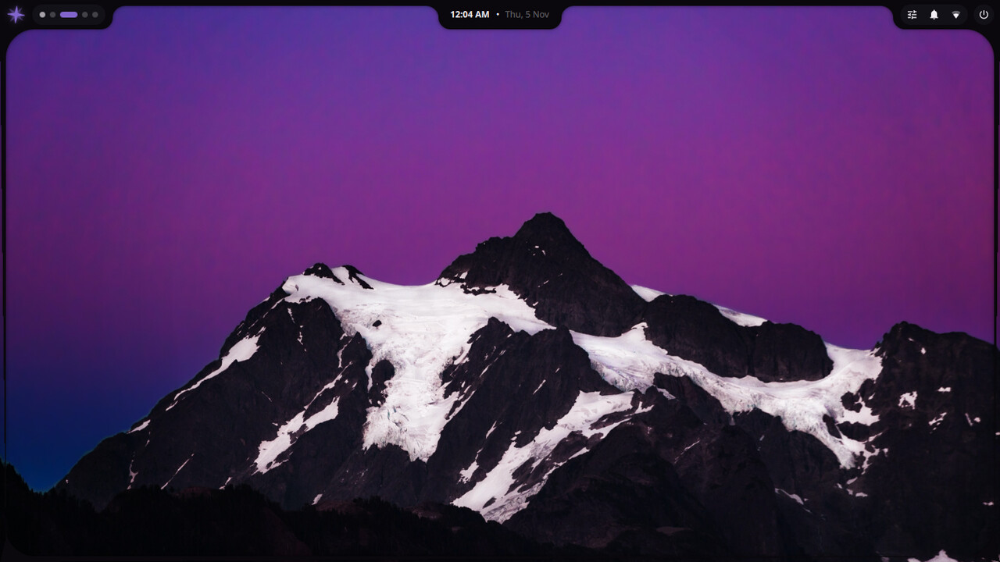

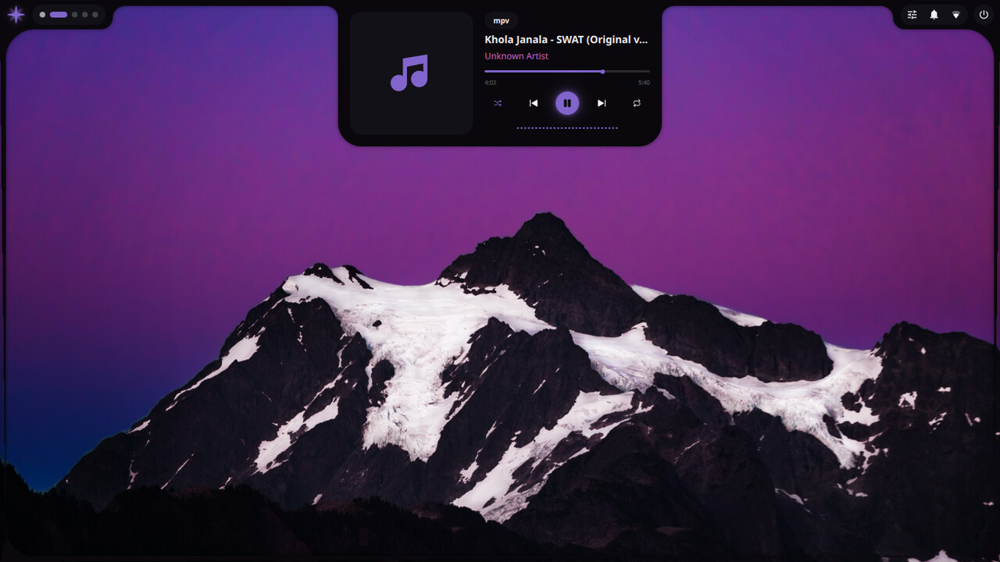

</details>

<details>
<summary><b>🏝️ Island</b> — a floating island that grows into the widget you open</summary>

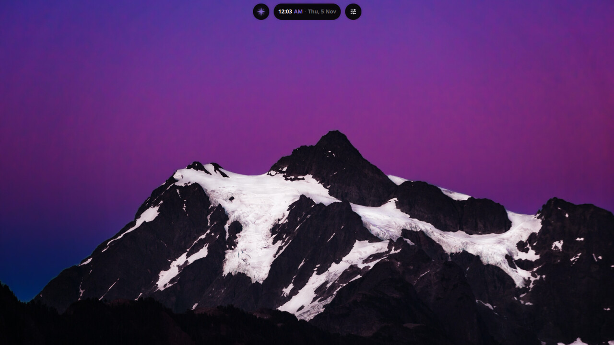

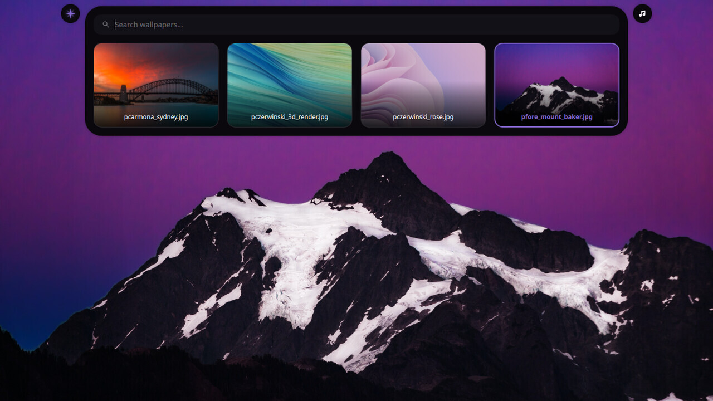

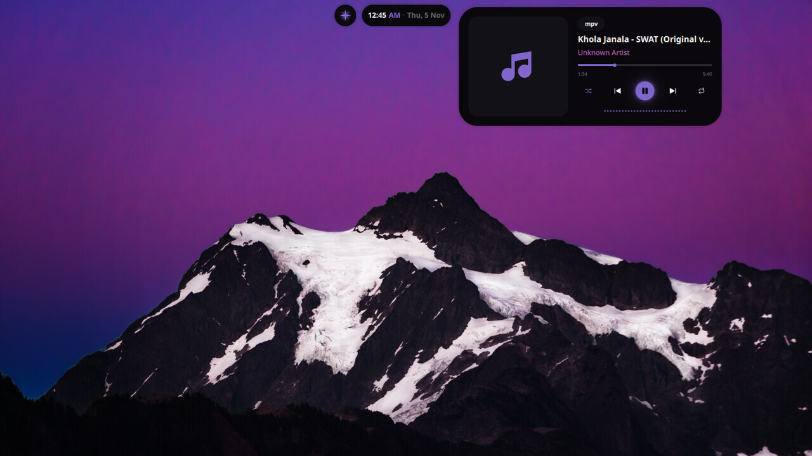

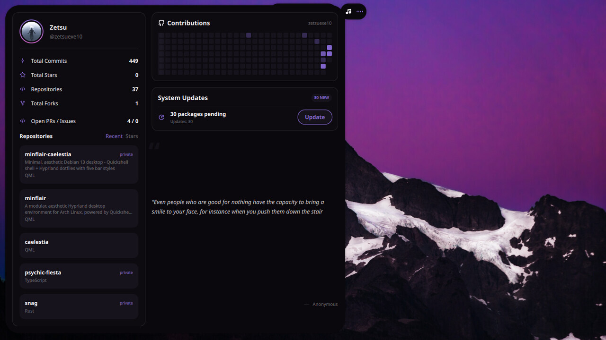

</details>

<details>
<summary><b>🪟 Side</b> — a frame around the screen, bar on one edge, panels grow out of it</summary>

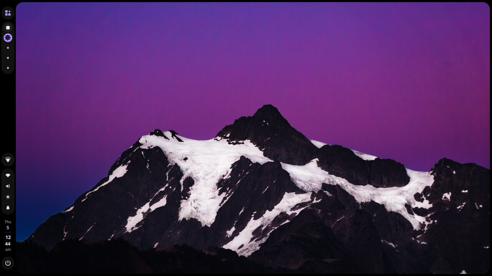

</details>

<details>
<summary><b>💊 Dynamic</b> — a compact pill; widgets morph out of the island</summary>

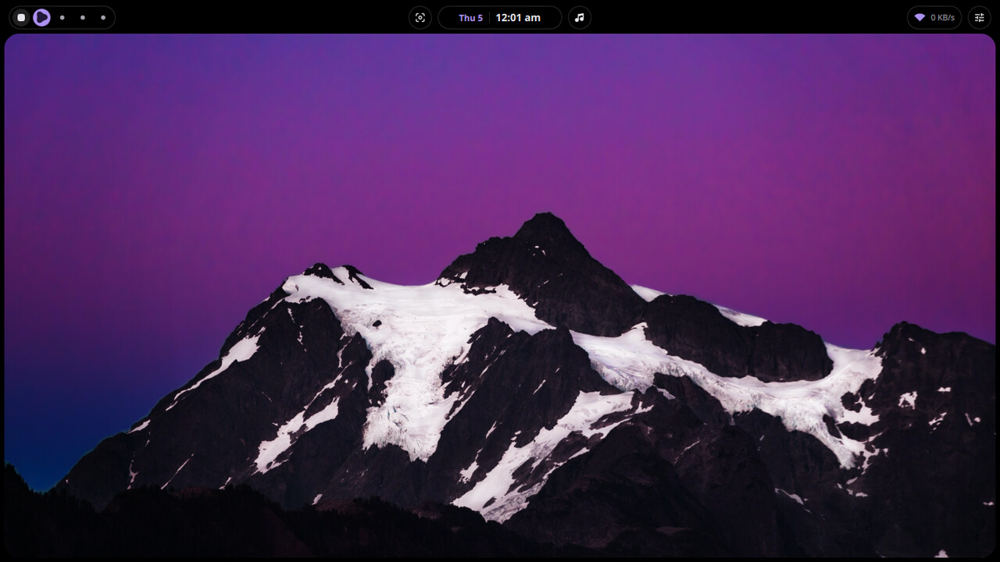


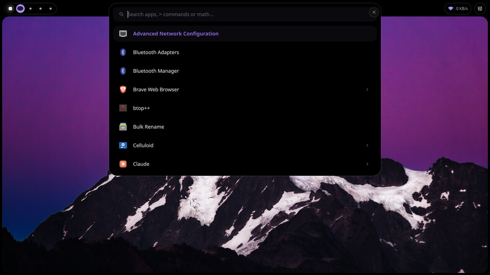

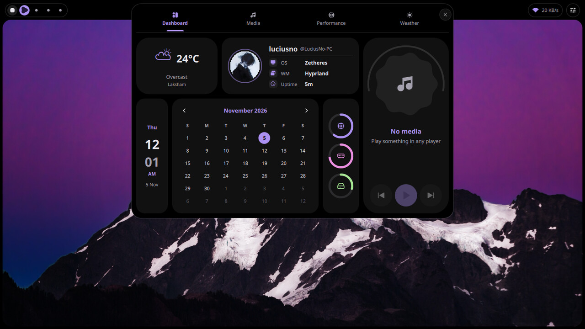

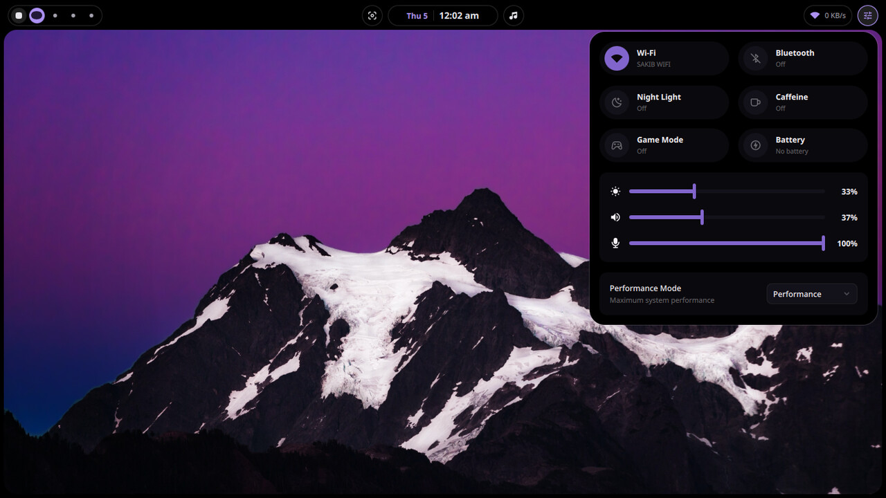

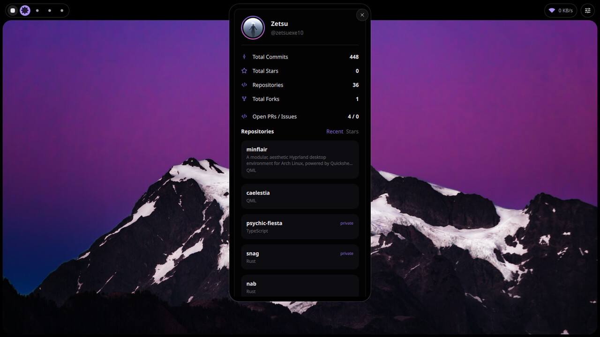

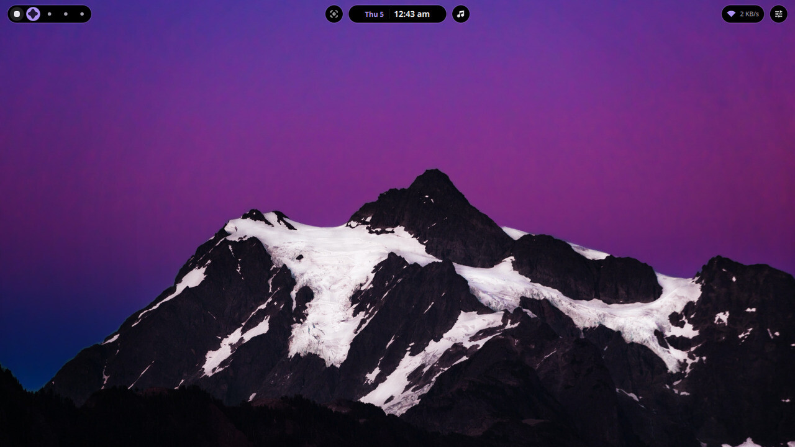

</details>

<a id="install"></a>

## 📦 Install

Requirements: Arch Linux or Debian 13, `git`, `sudo`, and a normal user (not root). Run it from a terminal.

**One command** (downloads the repository to `~/.minflair/src` and starts the installer):

```sh
curl -fsSL https://raw.githubusercontent.com/zetsuexe10/minflair/minflair/install.sh | bash
```

Pass options after `-s --`:

```sh
curl -fsSL https://raw.githubusercontent.com/zetsuexe10/minflair/minflair/install.sh | bash -s -- --yes --style side
```

**Or clone it yourself:**

```sh
git clone -b minflair https://github.com/zetsuexe10/minflair ~/minflair
cd ~/minflair
./install.sh
```

When it finishes, log out and choose **Minflair** in your login screen, or start it from a TTY with
`~/.minflair/bin/minflair-session`.

The installer asks before each step and takes the bracketed default on Enter. `--yes` answers yes to everything.

| Option | Effect |
| :-- | :-- |
| `-y`, `--yes` | answer yes to everything and use the defaults |
| `--style convex\|island\|side\|dynamic` | starting bar |
| `--terminal foot\|kitty\|alacritty\|wezterm` | terminal for `Super+Return` |
| `--files nautilus\|thunar\|dolphin` | file manager for `Super+E` |
| `--layout us,es` | keyboard layouts |
| `--no-packages`, `--no-shell`, `--no-hypr`, `--no-session`, `--no-services` | skip a step |
| `--aur-helper paru\|yay` | Arch only: helper for packages that are not in the repositories |
| `--greeter` | Debian/FlickOS only: also install the greetd login screen |
| `--check` | report what is installed and what is missing, change nothing |

```sh
./install.sh --yes --style side --terminal kitty --files thunar --layout us,es
```

| Step | What it does |
| :-- | :-- |
| Packages | Arch: pacman, plus an AUR helper for the rest. Debian: apt, with Hyprland and Quickshell from `trixie-backports` (enabled if missing). Requires Hyprland 0.55+ and Quickshell 0.3+ |
| Shell | copies `config/quickshell` to `~/.minflair/quickshell` and sets the starting bar |
| Hyprland | copies `config/hypr` to `~/.minflair/hypr` and writes your choices to `~/.minflair/hypr/local.lua` |
| Launchers | `~/.minflair/bin/qs` and `~/.minflair/bin/minflair-session` |
| Session | adds **Minflair** to `/usr/share/wayland-sessions` (sudo) |
| Services | enables NetworkManager and Bluetooth (sudo) |

Environment variables for the one-command install: `MINFLAIR_REF` (branch, default `minflair`), `MINFLAIR_SRC`
(where the repository is downloaded, default `~/.minflair/src`), `MINFLAIR_HOME` (install location, default
`~/.minflair`).

<a id="update-and-uninstall"></a>

## 🔄 Update and uninstall

| Task | Command |
| :-- | :-- |
| Update | run the one-command install again, or `git pull && ./install.sh --no-packages` in your clone |
| Uninstall | `./uninstall.sh` (or `~/.minflair/src/uninstall.sh`); `--keep-data` keeps theme output and backups |

Reinstalling moves the previous `~/.minflair/quickshell` and `~/.minflair/hypr` to `~/.minflair/backup/<date>`.
The uninstaller removes the session entry and `~/.minflair`. It never touches `~/.config` and never removes packages.

<a id="isolation"></a>

## 🧱 Isolation

| What | Where | Your setup |
| :-- | :-- | :-- |
| Shell | `~/.minflair/quickshell`, started as `qs -p ~/.minflair/quickshell` | `~/.config/quickshell` and other `qs -c` configs untouched |
| Hyprland config | `~/.minflair/hypr`, started with `Hyprland --config` | `~/.config/hypr` untouched |
| `qs` in the session | `~/.minflair/bin/qs` first in `PATH`, only inside the Minflair session | `qs` is unchanged in your other sessions |
| GTK / Qt theme | `~/.minflair/xdg` | `~/.config/gtk-*`, `qt*ct` and gsettings untouched |
| Session entry | `~/.minflair/bin/minflair-session` | your other session entries stay |

`Super+R` restarts only the Minflair shell. Settings you change in the shell, such as the GTK theme, cursor, icons,
fonts, monitor scale and keyboard layout, are saved under `~/.minflair` and restored on the next start. The shell keeps
its other preferences in `~/.cache/quickshell/settings_prefs.json`.

<a id="session"></a>

## 🖥️ Session

The installer adds `/usr/share/wayland-sessions/minflair.desktop`, so **Minflair** shows in SDDM, GDM, greetd, ly and
other display managers instead of "Hyprland". It runs `~/.minflair/bin/minflair-session`, which puts
`~/.minflair/bin` first in `PATH` and starts Hyprland with `~/.minflair/hypr/hyprland.lua`.

| | |
| :-- | :-- |
| Log | `~/.local/state/minflair/session.log` |
| From a TTY | `~/.minflair/bin/minflair-session` |
| `XDG_SESSION_DESKTOP` | `Minflair` |
| `XDG_CURRENT_DESKTOP` | `Hyprland`, so portals pick the Hyprland backend |
| Extra variables | `~/.minflair/session.env` |

<a id="hyprland-config"></a>

## 🌿 Hyprland config

`hyprland.lua` loads `animations`, `autostart`, `envs`, `keybinds`, `monitors`, `userprefs` and `windowrules`.
Autostart skips anything that is not installed.

| File | Holds |
| :-- | :-- |
| `local.lua` | terminal, floating terminal command, file manager, keyboard layout |
| `keybinds.lua` | every bind; the keybinds cheat sheet (`Super+K`) reads it |
| `autostart.lua` | idle daemon, clipboard history, keyring, polkit agent, wallpaper, the shell |
| `envs.lua` | environment, cursor, the GTK/Qt theme overlay |
| `monitors.lua`, `userprefs.lua` | monitor scale, input and general options |
| `windowrules.lua`, `animations.lua` | window rules and animations |
| `scripts/` | volume, brightness, media, touchpad, lock-key and polkit helpers |

<a id="keybinds"></a>

## ⌨️ Keybinds

`Super` is the logo key. `Super+K` shows them in the shell.

**🚀 Apps and tools**

| Key | Action |
| :-- | :-- |
| `Super+Return` / `Super+Shift+Return` | terminal / floating terminal |
| `Super+E` / `Super+B` | file manager / browser |
| `Super+Shift+C` | colour picker |
| `Super+Z` | quick panel: Wi-Fi, brightness, volume |
| `Super+Space` | switch keyboard layout |
| `Super+R` | restart the shell |
| `Super+Ctrl+T` | toggle touchpad |

**🐚 Shell**

| Key | Action |
| :-- | :-- |
| `Super+A` | launcher |
| `Ctrl+Alt+S` or `Super+Shift+A` | control center |
| `Ctrl+Alt+D` or `Super+Shift+D` | dashboard |
| `Super+Shift+I` | GitHub widget |
| `Ctrl+Alt+M` | music |
| `Ctrl+Alt+N` / `Ctrl+Alt+C` | notifications / calendar |
| `Ctrl+Alt+F` or `Super+Shift+U` | system usage |
| `Ctrl+Alt+T` | pomodoro |
| `Ctrl+Alt+W` or `Super+Shift+W` | wallpaper selector |
| `Ctrl+Alt+X` or `Super+Shift+X` | power menu |
| `Super+X` | power menu (Dynamic bar) |
| `Super+V` | clipboard history |
| `Super+Shift+S` | screenshot / recording |
| `Super+S` / `Super+Ctrl+S` | settings / settings on the Bar page |
| `Super+L` | lock screen |

**🪟 Windows**

| Key | Action |
| :-- | :-- |
| `Super+Q` | close |
| `Super+W` | toggle floating |
| `Super+F` / `Super+Shift+F` | maximize / fullscreen |
| `Super+J` / `Super+P` | toggle split / pseudo-tile |
| `Super+C` / `Super+Shift+P` | center floating / pin |
| `Super+N` / `Super+Shift+N` | minimize / restore minimized |
| `Super+G` / `Super+Tab` / `Super+Shift+G` | group / cycle group / lock group |
| `Super+Shift+M` | exit Hyprland |

**🧭 Navigation**

| Key | Action |
| :-- | :-- |
| `Super+Arrows` | focus |
| `Super+Shift+Arrows` | move window |
| `Super+Alt+Arrows` | resize |
| `Super+Alt+Shift+Arrows` | swap |
| `Super+1..0` / `Super+Shift+1..0` | workspace / send window there |
| `Super+Ctrl+Left/Right`, `Super+Scroll` | previous / next workspace |
| `Super+Mouse left/right drag` | move / resize window |

**🎛️ Bars**

| Key | Action |
| :-- | :-- |
| `Super+Alt+B` / `Super+Alt+Shift+B` | next / previous bar |
| `Super+Alt+1` ... `4` | Convex / Island / Side / Dynamic |

Media, volume, brightness, mic-mute, touchpad and Caps/Num-lock keys work with an on-screen display. Panels toggle
through sockets, so any keybinding tool can use `socat - UNIX-CONNECT:/tmp/quickshell_<panel>` with `launcher`,
`clipboard`, `wallpaper`, `powerMenu`, `controlCenter`, `dashboard`, `github`, `notificationsCenter`, `calendar`,
`music`, `systemUsage` or `screenshot`. Other commands:

| Command | Effect |
| :-- | :-- |
| `qs ipc call bar cycle\|prev\|get` | next, previous, or print the current bar |
| `qs ipc call bar set <convex\|island\|side\|dynamic>` | switch bar |
| `qs ipc call settings open <page>` | open Settings on a page (`bar`, `side`, `dynamic`, `profile`, ...) |

<a id="bars"></a>

## 🎛️ Bars

<a id="convex-and-island"></a>

### 🏝️ Convex and Island

Convex is the classic curved top bar: workspaces and the focused window on the left, the clock pill in the centre,
network and status icons on the right. Island floats at the top centre and grows when a widget opens (media, launcher,
wallpaper, dashboard), then shrinks back. Settings > Island can collapse it to a single pill, choose what the right
circle shows and show or hide workspaces and the tray.

<a id="side"></a>

### 🪟 Side

A solid frame around the screen, thick on the bar's edge, with panels that grow out of it. It has its own palette
(AMOLED by default; Mode under Settings > Side · Frame switches to Dark, Light or follow-theme), the Caelestia
dashboard, launcher, power panel and Wi-Fi / Bluetooth / sound popouts.

| Part | Details |
| :-- | :-- |
| Edge | left, right, top or bottom (Settings > Side) |
| Panels | power panel on the right edge, dashboard on the top, launcher (off by default) on the bottom; Wi-Fi, Bluetooth, sound, calendar and notifications from their bar icons; wallpaper and screenshot drop from the top |
| Space | the frame reserves its thickness |
| Scrolling | first half of the bar changes volume, second half brightness, over the workspaces switches workspace |

**🧷 Entries.** Each can be turned off in Settings > Side.

| Entry | Shows |
| :-- | :-- |
| Launcher | opens the launcher |
| Workspaces | small circles for empty, rounded squares for occupied, a polygon for the active one; numbers and app-icon styles also available |
| Active window | title of the focused window |
| Tray | tray icons |
| Status | network, Bluetooth, volume, brightness, keyboard layout, lock keys, notifications |
| Clock | date and time; click opens the calendar |
| Now playing | the song with its cover (only while a player runs), in the middle of the bar; hover or click opens the player |
| Power | hover or click opens the power panel |

**📐 Layout.** Settings > Side · Layout puts every entry in the **Start**, **Centre** or **End** part of the bar and sets
its order inside that part (lowest first). The centre part is centred on the screen edge, so the song stays in the
middle.

| Entry | Default part | Default order |
| :-- | :-- | :-: |
| Launcher button | Start | 1 |
| Workspaces | Start | 2 |
| Active window | Start | 3 |
| Now playing | Centre | 1 |
| System tray | End | 1 |
| Status icons | End | 2 |
| Clock | End | 3 |
| Power button | End | 4 |

**💊 Dynamic mode.** Off by default. The bar shrinks to a small capsule and grows back on demand.

| | Behaviour |
| :-- | :-- |
| Resting state | capsule with workspaces, the song in the middle (while a player runs) and the clock |
| Grow | hover, or click when "Expand on hover" is off |
| Shrink | when the pointer leaves |
| Song | hover or click opens a compact player (cover, title, seek bar, previous, play, next) out of the bar, centred on the song |

| Setting (Settings > Side > Dynamic mode) | Effect |
| :-- | :-- |
| Dynamic bar | shrink the bar to a capsule |
| Expand on hover | off: click the capsule to expand |
| Keep expanded | always show the whole bar |
| Music card on hover | hover the song to open the player; click always works |

<a id="dynamic"></a>

### 💊 Dynamic

A floating pill at the top centre. Scroll or drag it to switch between the clock, now playing and notifications; hover
to peek at the song. Workspaces sit in their own chip on the left and a round music button on the right opens the
player. The wallpaper picker, screenshot, clipboard, power, launcher, dashboard and GitHub widgets open inside the
island, and arrow keys browse the wallpaper list.

| Setting (Settings > Dynamic) | Effect |
| :-- | :-- |
| Music button | round button beside the pill |
| Hover peek | hover shows the song |
| Swipe and scroll | scroll or drag the pill to change view |
| Reserve space | tiled windows stop below the pill |
| Idle view | what the pill returns to: automatic, time, music or notifications |
| Views | clock, workspaces, music, notifications |
| Screen frame | optional border like the Side bar; thickness, rounding and colours come from Side |

### 🎚️ On-screen display

Volume and brightness changes show a Caelestia-style slider card on the right edge of the screen. It works with every
bar, can be switched off per bar in Settings (each bar page has an On-screen display toggle) and you can drag the
sliders while it is visible. Settings > Panels sets the hide delay and an optional microphone slider. With it off, the
bar's own native indicator is used. Trigger it from scripts with `qs ipc call osd showVolume` or `showBrightness`.

### 🎛️ Quick panel

`Super+Z` opens an iPhone-style control panel: a Wi-Fi tile (toggle the radio, open the network list to scan, connect
with a password, disconnect or forget), Sound and Mic toggles and draggable brightness and volume sliders. On the
Dynamic bar it grows out of the island (also under Controls in the tools menu); on the other bars it opens as a
centred popup.

<a id="dashboard"></a>

## 📊 Dashboard

Tabs: Dashboard, Media, Performance, Weather. Left/Right, Tab and Home/End switch, Escape closes.

| Part | Details |
| :-- | :-- |
| User card | round avatar from your logo image, then `~/.face`, then the distro logo, then your initial; the OS row reads the brand from `/etc/issue` and `os-release` ("OS name" in Settings > Panels overrides it) |
| Media | cover that turns while playing with an audio-reactive ring (needs `cava`), title, artist, album, seek bar, shuffle / previous / play / next / repeat, synced lyrics from lrclib.net, a player selector |
| Performance | usage gauges for the system |
| Weather | forecast for the city set in Panels, or located by IP |

Wallpapers come from `~/Pictures/Wallpapers` and `/usr/share/backgrounds`, subfolders included; the folder list is
editable in Settings > Wallpaper. Arrow keys browse, Enter sets.

<a id="widgets"></a>

## 🧰 Widgets

Every widget is one QML component loaded into whichever surface the active bar provides: a popout, a panel grown from
the frame, the inside of the island or a standalone window. Panels toggle through
`socat - UNIX-CONNECT:/tmp/quickshell_<panel>`.

| Widget | Key | What it does |
| :-- | :-- | :-- |
| 🎛️ Quick panel | `Super+Z` | Wi-Fi scan and connect, brightness and volume sliders |
| 🚀 Launcher | `Super+A` | fuzzy app search with app actions, inline calculator, `>` commands, web prefixes `g` `yt` `w` `gh` `ddg` |
| 📊 Dashboard | `Super+Shift+D` | Caelestia's four tabs on Side and Dynamic, a compact GitHub and system card on Convex and Island |
| 🎵 Media | `Ctrl+Alt+M` | cover, title, seek bar and transport controls |
| 🐙 GitHub | `Super+Shift+I` | profile card, totals, repositories sorted by activity or stars |
| 🎚️ Control centre | `Ctrl+Alt+S` | Wi-Fi, Bluetooth, night light, caffeine, game mode, sliders, performance mode |
| 🔔 Notifications, calendar | `Ctrl+Alt+N`, `Ctrl+Alt+C` | popups on every bar, history, month grid |
| 📋 Clipboard | `Super+V` | `cliphist` history with images and search |
| 🖼️ Wallpaper selector | `Ctrl+Alt+W` | browse and apply; regenerates the palette and GTK/Qt theme |
| 📸 Screen capture | `Super+Shift+S` | screenshots, OCR text extraction, screen recording |
| ⏻ Power menu | `Ctrl+Alt+X`, `Super+X` on Dynamic | lock, log out, suspend, reboot, shut down with confirmation |
| 🍅 Pomodoro, system usage | `Ctrl+Alt+T`, `Ctrl+Alt+F` | focus timer that survives restarts; CPU, memory, disk and GPU |
| 🔒 Lock screen | `Super+L` | Quickshell's own, PAM authentication, your profile picture |

**Launcher.** Arrow keys move, Enter opens, Escape closes. A web prefix only becomes a search after a space, so typing
an app name that starts with `g` still searches apps. Anything after `>` that is not a Minflair action is offered as a
shell command.

**GitHub.** Set the username and token under Settings > Integrations & Apps. A token with `repo` scope adds private
repositories and commit totals; without one the public API works at a lower rate limit. The token is stored in
`~/.cache/quickshell/settings_prefs.json` (mode `600`), handed to the fetch scripts through the environment, and only
ever sent to GitHub.

**Screen capture.** Full screen, area, current window (with or without a 3 second delay), text extraction (`tesseract`,
English and Spanish), area or full-screen recording with `wf-recorder`. Shots go to `~/Pictures/Screenshots` and the
clipboard.

**Pomodoro.** 25 minute focus, 5 minute breaks, 15 minute long break every fourth session, with auto-start,
notifications and sound options.

<a id="profile"></a>

## 👤 Profile and lock screen

Settings > Profile is an identity card and the place where the lock-screen picture is chosen. It shows account name,
hostname, distro, desktop, kernel, display server, package count, processor, memory, storage and graphics, read from
the running system when the page opens.

**Picture chain**, used by the Profile page and the lock screen:

1. the picture chosen in Settings > Profile
2. `~/.face`
3. the distro logo from the icon theme
4. the account initial on the accent circle

| Control | Effect |
| :-- | :-- |
| Choose picture | opens the desktop's own file chooser through `xdg-desktop-portal` (Images filter); cancelling keeps the current picture |
| Image path | type or paste a path (`~/Pictures/me.jpg` or a `file://` URI) and press Enter |
| Thumbnail grid | built-in fallback over `~/Pictures`, `~/.face` and `/usr/share/backgrounds` when the portal is missing |
| Reset | back to `~/.face`, the distro logo, then the initial |

The dashboard user card has its own logo setting under Settings > Panels, with the same fallbacks.

<a id="wallpaper-and-theming"></a>

## 🎨 Wallpaper and theming

| | |
| :-- | :-- |
| Folders | `~/Pictures/Wallpapers` (subfolders, five levels deep) and `/usr/share/backgrounds`; editable in Settings > Wallpaper |
| Formats | JPG, PNG, WebP, GIF |
| Apply | click a thumbnail, press Enter in the wallpaper panel, **Shuffle** for a random one, **Browse** for a file; drawn by `swaybg` |
| Palette | derived from the wallpaper accent; applying a wallpaper regenerates the shell colours, the GTK/Qt overlay and the greeter colours |
| Side colour mode | AMOLED (pure black, default), Dark, Light or follow the theme; set under Settings > Side · Frame |
| Screen frame | Side (on by default) and Dynamic (off by default) can draw a border with rounded inner corners; thickness and rounding live on the Side · Frame page |

<a id="settings"></a>

## ⚙️ Settings

`Super+S` opens one window with a search box and a grouped sidebar. Each bar has its own page.

| Section | Pages |
| :-- | :-- |
| Profile | account, host, distro and the picture used by the lock screen |
| Desktop | Appearance, Wallpaper, Bar (active bar, clock and workspaces shared by every bar), Panels (dashboard, weather), Visual Effects, Windows & Display |
| Bars | Convex, Island, Side (with Side · Layout and Side · Frame), Dynamic; reset buttons on Side · Layout and Dynamic |
| Input & hardware | Mouse & Touchpad, Keyboard & Clipboard |
| System | App Appearance, Integrations & Apps (default apps, GitHub account, token and overview) |
| About | Shortcuts, About System |

**App Appearance** (GTK theme, app font and size, icon theme, cursor theme and size) is written to `~/.minflair` only
and restored on every start. Apps started from the launcher or the Minflair session pick it up; apps already running
keep their old look until restarted. The shell font is separate from the app font. The GitHub token is passed to the
fetch scripts through the environment, never on a command line.

<a id="architecture"></a>

## 🏗️ Architecture

| Part | How it works |
| :-- | :-- |
| Shell | one Quickshell process, `qs -p ~/.minflair/quickshell`, owns every bar, panel and the lock screen |
| Bars | `Modules/Bar/Styles/{Convex,Island,Side,Dynamic}`; the active one is chosen by `SettingsService.barStyle` |
| Widgets | loaded by `Core/Windows/WidgetLoader.qml` into the surface the active bar provides |
| Panel sockets | each widget listens on `/tmp/quickshell_<widgetId>` for toggles |
| IPC | `qs ipc call bar ...`, `qs ipc call settings open <page>`, `qs ipc call widgets toggle <id>` |
| Preferences | `~/.cache/quickshell/settings_prefs.json`; theme and app appearance in `~/.minflair/theme.json` |
| Hyprland | `~/.minflair/hypr`, started by `minflair-session` |

```text
config/
  hypr/                     Hyprland Lua config and helper scripts
  quickshell/
    shell.qml               entry point
    Core/                   services, theme, widget loader
    Modules/
      Bar/Styles/           Convex, Island, Side, Dynamic
      Dashboard, Launcher, ControlCenter, Clipboard, ScreenCapture,
      WallpaperSelector, PowerMenu, Notifications, Pomodoro, LockScreen, ...
      ControlPanel/         quick panel (Wi-Fi, brightness, volume)
      Osd/                  right-edge volume and brightness display
      Settings/             the settings window and its pages
    Scripts/                theme, system and helper scripts
bin/                        qs shim and minflair-session
greeter/                    optional greetd login screen
tools/                      doctor, smoke test, greeter installer, hero image builder
install.sh, uninstall.sh
```

<a id="packages"></a>

## 🧩 Packages

`./install.sh --check` lists what is missing. Quickshell must be 0.3 or newer; on Arch use `quickshell-git` from the AUR
if the repository version is older.

| Group | Arch | Debian 13 |
| :-- | :-- | :-- |
| Core | `hyprland` `quickshell` `hypridle` `hyprpolkitagent` `hyprpicker` `xdg-desktop-portal-hyprland` `xdg-desktop-portal-gtk` `qt6-wayland` | the same plus `hyprlock` `hyprsunset`; Hyprland and Quickshell from `trixie-backports` |
| Shell | `python` `python-pillow` `python-gobject` `socat` `jq` `wl-clipboard` `cliphist` `brightnessctl` `playerctl` `swaybg` `grim` `slurp` `wf-recorder` `tesseract` `imagemagick` `libnotify` | `python3` `python3-gi` `python3-pam` `python3-pil` and the same tools (`libnotify-bin`, `tesseract-ocr`) |
| System | `networkmanager` `network-manager-applet` `bluez` `power-profiles-daemon` `upower` `pipewire` `wireplumber` `gnome-keyring` | `network-manager` `network-manager-gnome` and the same |
| Look | `ttf-inter` `adw-gtk-theme` `qt6ct` `cava` `zenity` `papirus-icon-theme` `noto-fonts` | `fonts-inter` `adw-gtk3` `qt6ct` `cava` `zenity` `papirus-icon-theme` `fonts-noto-*` |
| Your choice | terminal (`foot` `kitty` `alacritty` `wezterm`), file manager (`nautilus` `thunar` `dolphin`) | same |

The cursor theme `Vimix-cursors` is optional and not packaged on Debian
(`git clone https://github.com/vinceliuice/Vimix-cursors && cd Vimix-cursors && ./install.sh`); Adwaita is used until
then.

<a id="login-screen"></a>

## 🔐 Login screen

Debian/FlickOS only, optional. `./install.sh --greeter` (or `sudo tools/install-greeter.sh`) installs a Quickshell
greeter on greetd inside cage: user, password and a session picker with readable names from
`/usr/share/wayland-sessions`. Colours and the blurred wallpaper follow the shell. `sudo tools/install-greeter.sh
--revert` restores the original greeter. Log: `/var/tmp/minflair-greeter/greeter.log`. Layout and icons are adapted
from the Archcraft SDDM theme (GPLv3, see `greeter/assets/NOTICE`). On other display managers (SDDM, GDM, ly) the
**Minflair** session entry is enough.

<a id="troubleshooting"></a>

## 🛠️ Troubleshooting

| Symptom | What to do |
| :-- | :-- |
| Nothing loads | run `./tools/doctor.sh` inside the session and send the output; or run `~/.minflair/bin/qs` in a terminal and read the errors; `~/.minflair/bin/qs log` shows the last run |
| QML errors after an edit | `./tools/smoke-test.sh config/quickshell` loads the shell offscreen and reports load errors |
| Session does not start | read `~/.local/state/minflair/session.log` |
| Minflair does not show in SDDM | the session file must not contain `TryExec`; run `./install.sh --session --no-packages --no-shell --no-hypr`, then `sudo systemctl restart sddm` |
| Keys do nothing in the launcher, wallpaper selector or screenshot panel | right after opening the launcher run `~/.minflair/bin/qs log \| grep "side overlay focus"` and send the output |
| Theme, cursor or font did not change | apps already running keep the old look until restarted; check Settings > App Appearance > Status says "Active" |
| One-command install fails to download | check that `git` is installed and `https://github.com` is reachable, then run it again |
| Package updates | detected for pacman, AUR (paru/yay), apt and dnf |

<a id="credits"></a>

## 💜 Credits

| | |
| :-- | :-- |
| 💠 **Minflair (Debian)** | the original shell and Hyprland config this unified branch builds on |
| 🌌 **Caelestia** | the look of the Side bar, frame, workspace indicators and dashboard are inspired by the [Caelestia](https://github.com/caelestia-dots) shell |
| ⚡ **Quickshell, Hyprland** | the toolkit and the compositor everything runs on |
| 🎨 **Archcraft SDDM theme** | layout and icons of the greeter (GPLv3, see `greeter/assets/NOTICE`) |

<a id="license"></a>

## 📄 License

See `LICENSE`.
